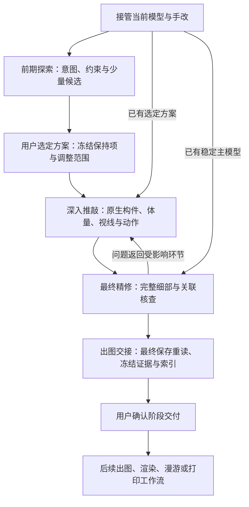

# 可复用建模流程

这是一组按需进入的阶段，不是每次修改都要走完的审批链。阶段通过由证据判断，已有用户确认不重复征求。只有真实设计分歧需要用户决策。开始前定位五阶段中的实际位置。

## 0. 接管当前状态

**输入**：用户当前模型、最近批注/决策、任务书、现状边界、已有交接资料。

**动作**：识别唯一编辑源、打开文档、未保存修改和临时回退；记录文件指纹、单位、坐标系、建筑零点。列出不可改变的空间关系、可以调整的范围和本轮交付。把“已确认”“推定”“未知”分别记录，不把过期根目录 README 当作最新方案。

**产物**：简短项目简报与当前轮次基线；指向项目固定的当前事实底表。已有数据完整则引用，不重抄。跨对话入口与维护规则见[项目上下文](project-context.md)。

**通过条件**：能指出从哪个文件继续、哪些内容来自用户手改、哪些设计不能被生成器重新覆盖。若磁盘与窗口冲突，先确定哪一份包含最新工作；可先独立检查已保存文件，不执行破坏性的还原。

## 1. 前期方案探索（exploration）

输入可以是任务书、场地、草图或用户草模。先提炼空间意图与关键约束，区分已确认、推定和未知。若研究功能，先写生活场景；若研究空间，先比较剖面、光线和视线，不强迫先分房。空间功能可以待定，不能猜造用户决定。

已有区域身份沿用。核对标高、室内外、保留侧墙、边界、上人要求，分别记录通行、视线、隐私和支承联系。图上投影相邻不代表可走，视觉贯通不等于必须增设楼梯。

围绕真正的分歧生成少量不同候选；同视角比较空间收益和代价。检查场地边界、关键路径/标高可行性和主要使用关系，暂定节点保留暂定。探索方向由用户判断，技术小修不用逐次审批。

通过条件：候选差异能回答当前问题，关键约束和未知项明确；尚未选案不宣称可进入最终精修。允许用户直接给定方案。

## 2. 选定方案（selection）

保留用户明确选择、实际候选模型、选择理由、必须保持的体量/空隙/错层视线与允许调整范围。记录选案来源及废止的旧决定。未决问题区分是否阻塞下一步。阶段内整理选定基线，不继续批量生成替代方案。

通过条件：能定位用户选中的文件和版本，下一位接手者能分清保持项与暂定项；选案不能由 AI 自行登记为用户批准。已有交接满足这些条件则直接接续。

## 3. 深入推敲（development）

从选定空间策略落实原生墙板、交通、围合、洞口和家具占位。先列起终点及功能名，再生成楼梯；同层连接也检查墙、门槛、落脚和转向。梯跑、梯组和入口数分开。联合审查体量、净使用面、采光、视线和关键接口，不能只看零碰撞。

先做代表样件，实际双向检查必要路线。尺寸依据来自本项目及当前适用官方依据；示例尺寸不是规范。涉及已确认空间关系的重大变更由用户决定，常规原生构件实现与修复连续完成。

### 原生可编辑模型

**输入**：已选空间/交通策略，或用户手改后的原生模型。

**动作**：先做墙、板、带洞口围护、楼梯连接的代表样件。构件按使用目的分组，维持可检索身份；同一构件的真实厚度、面环、共享边和法线正确。重复件可使用组件/实例，但独立编辑对象不能意外联动；导出器必须能遍历实际层级和实例。

由用户手改后重新读取实际几何。原参数与手工模型分歧时，以已选权威来源为准，不自动重生成。对手工变化保留前后差异证据。

**产物**：正常可选、可进入、可编辑、可保存的主模型；结构替代表达和展示隐藏与建筑真实构件区分。

**通过条件**：原生选择、选面、推拉/等价操作与撤销实际测试通过；保存重开后尺寸/体积、洞口、单位和层级一致。测试改动撤销，不混入交付。

## 4. 最终精修（refinement）

**输入**：稳定建筑主模型、功能需求、已确认风格和关键参考。

采用两条交织的顺序，而不是先做完全部家具再考虑结构：

1. **使用顺序**：入口与通道 → 活动区域 → 家具尺寸和操作净空 → 视线、隐私、光线 → 材料与小物。
2. **构件顺序**：墙板及结构支承 → 楼梯与洞口 → 门窗和栏杆 → 铺装与收口 → 固定家具 → 灯帘及环境。

先用简化结构和家具占位找冲突，确认后再细化。不要一开始追求节点工程细节；结构几何的目的与计算状态分开标注。每轮选一个区域或一个系统连同其受影响邻接处，一次做完可使用的闭环。

### 本轮修改卡

写清目标、保留项、目标实体ID/路径、允许变化项和受影响的下游对象。维护当前功能/材料表，后续用户更正覆盖旧行并保留来源，而不是靠不断追加段落理解最后意图。

目标至少区分空间意图与技术条件：需要保留的高差/视线、允许占用的体量、主要使用动作，以及真实围合/支承关系。用关键剖面或同视角原生模型审查前两项，再用尺寸和动作检查后两项。不能只因所有碰撞测试通过就认定方案符合意图。

修复穿模或悬空前，先写原构件承担的功能与连接对象。修复后既检查相交，也检查是否失去围合、支承、隐私或通行。调整动作位置或核查范围时记录旧范围、新范围及使用理由，不能通过缩小检查范围把同一缺陷隐藏起来。

### 最小验证闭环

交通或家具影响出入时，先在本轮修改卡填写动作链、各段脚下承托、门扇状态和两端转向空间。优先验证最危险的接口样件，再扩展细节。每条路线填写适用版本及检查状态；未覆盖的路线保持待核查，不以本轮局部通过代替。

1. 重新读取当前基线；中途发现用户手改则重新对比，不覆盖。
2. 修改目标；完成一处关键样件后再推广。
3. 查目标本体：尺寸、闭合、洞口、完成面和可编辑性。
4. 查关系：通行、门扇、护栏连续、支承/安装、材料收口、互斥场景。
5. 查影响：邻接构件碰撞/重复、路径净空及首末踏步；比较范围外几何与材质。
6. 候选预检后完成原生编辑/撤销、必要场景整理和最终保存；从磁盘重读，对实际文件重查本体、邻接与范围外，再查看同版原生场景和局部近景。任何后续写回都会触发对应证据重新绑定。
7. 若本轮改变功能、连接、约束或版本，回写当前底表和废止关系，刷新固定入口；不将过期参数备注继续当作当前输入。

**通过条件**：满足本轮使用意图；未授权范围没有变化；不出现未解释的碰撞、缺口和悬空安装；相关派生结果已更新或明确失效。

写入、保存重读、几何核查和渲染有先后依赖，不并行读取正在生成的文件。状态迁移以退出码、文件及对应指纹为依据。回归缺陷先在旧模型中复现；保存后的模型通过后，才更新事实底表及正式核查基准。

## 5. 出图交接（handoff）

**输入**：本阶段已完成的主模型及检查证据。

**动作**：在阶段节点复核全屋关键路径、临空边、防护转角、完整/剖览场景、地下空间、开口和完成面。验证主模型、导出数据和报告是否来自同版，保留未决问题。

**产物**：唯一交接入口、可编辑 SKP、含原生内外面环及实例变换的米制几何、材料/相机/场景/切面索引、坐标与标高、最新约束、证据清单、未决项和回退位置。所有写回后保存重读，再冻结指纹。用一张复杂平面和一张关键剖面的底稿验证数据可读；最终图纸转交出图工作流。

**通过条件**：另一位接手者能独立选对文件，知道真实空间与展示设置的差别，知道哪些检查完成、哪些仍待处理。阶段冻结不等于禁止修改；后续修改产生新修订并触发相关派生更新。

### 后续派生边界

| 分支 | 继承什么 | 允许变化 | 必须再检查 |
|---|---|---|---|
| 建筑图纸 | 同版几何、平台ID、标高、单位、室内外边界 | 线型、符号、剖切与图面简化 | 先验一张关键剖面和一张复杂平面；比例、标高、楼梯方向、尺寸闭合、遮挡；几何更正必须回写建筑或登记差异 |
| Blender 表现 | 世界坐标、稳定ID、材料映射、选定可见状态 | 灯光、纹理、微倒角、表现配景 | 校准长度、标高、包围盒、坐标与材质分配、保存重开；确认完整围护，避免把剖览场景直接当完整建筑 |
| Unity 体验/选镜头 | 同版空间、简化碰撞、坐标转换和源指纹 | 交互、实时材质、相机 | 连续双向路径；镜头持久化及回传投影；自由飞行通过不等于步行通过；直观调光不等于定量日照 |
| 打印 | 冻结建筑几何和定位装配关系 | 独立副本的缩尺、简化、加厚、圆角及拆件 | 单位与是否已缩尺、实测包围盒、封闭连通、逐级楼梯方向、配合几何、参考切片及试片；切片通过不等于实物通过 |

派生件每个都记录源指纹、规则/脚本版本和输出指纹。已有人工材质、镜头、Figma精绘或打印调整时，更新前核对并保留这些改动，不能整份覆盖重导。先按稳定ID同步；工具不支持增量时，保留旧成果，在副本中受控重建并比较。

## 下一轮改进

只保留能改变下一次做法的记录：用户不得不重复指出的问题、首次发现的阶段、遗漏的依赖、有效的验证方法。将重复发生的问题升级为样件/检查规则，而不是不断扩大报告。

建议跟踪：用户发现的重复缺陷数、发布后才发现的关键缺陷数、误用版本次数、原生编辑阻碍次数、首个有效候选耗时。没有连续日志时不要编造节时百分比；有成本时再测量。
